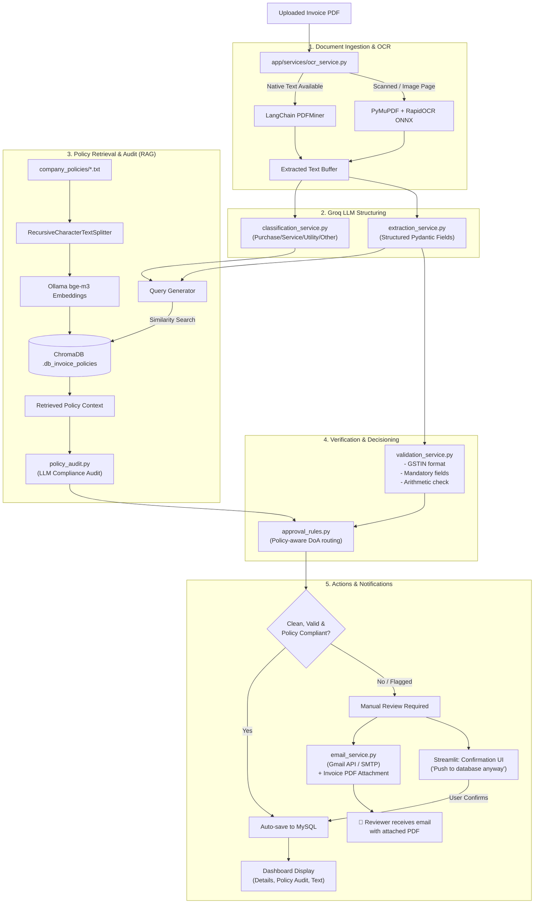

# InvoIQ: Intelligent Invoice Review & Policy Audit System

[](https://www.python.org/)
[](https://streamlit.io/)
[](https://www.langchain.com/)
[](https://groq.com/)
[](https://ollama.com/)
[](https://www.trychroma.com/)
[](https://www.mysql.com/)
[](https://developers.google.com/gmail/api)
[](LICENSE)

An enterprise-ready **Retrieval-Augmented Generation (RAG)** and document intelligence solution designed to automate accounts payable, invoice verification, compliance auditing, approval workflows, and reviewer email notifications.

**AutoMobile_RAG** ingests raw digital or scanned invoice PDFs, executes local OCR, classifies invoice categories, extracts structured data with Groq LLMs, audits line items against company policies via ChromaDB vector retrieval, validates GST and arithmetic integrity, routes approvals according to corporate delegation of authority, emails flagged invoices (with PDF attachment) to manual reviewers via Gmail API, and archives auditable records to MySQL.

---

## Table of Contents

- [Key Features](#key-features)
- [System Architecture](#system-architecture)
- [Repository Structure](#repository-structure)
- [Technology Stack](#technology-stack)
- [Corporate Policies & Approval Rules](#corporate-policies--approval-rules)
- [Prerequisites](#prerequisites)
- [Installation & Setup](#installation--setup)
- [Environment Variables](#environment-variables)
- [Gmail OAuth2 Setup](#gmail-oauth2-setup)
- [Running the Application](#running-the-application)
- [End-to-End Processing Pipeline](#end-to-end-processing-pipeline)
- [Email Notification System](#email-notification-system)
- [Database Schema](#database-schema)
- [Troubleshooting & FAQ](#troubleshooting--faq)
- [Security Notes](#security-notes)
- [License](#license)

---

## Key Features

- **Hybrid PDF Text & Local OCR Extraction**:
  Fast native text extraction via LangChain `PDFMinerParser` with an automatic, local fallback to `PyMuPDF` (`fitz`) and `RapidOCR` (ONNX Runtime) for scanned invoices and image pages—no data leaves the local machine during OCR. Malformed PDFs are handled gracefully with automatic OCR fallback on all pages.

- **Structured LLM Extraction & Classification**:
  Leverages Groq's low-latency inference engine via a centralized LLM factory (`llm_service.py`) with strict Pydantic JSON schema constraints to classify invoices (`Purchase`, `Service`, `Utility`, `Other`) and parse critical metadata (invoice number, vendor name, GSTIN, dates, PO numbers, subtotal, CGST, SGST, IGST, and total amounts).

- **Policy-Aware Retrieval-Augmented Generation (RAG)**:
  Indexes company governance policies (GST rules, expense guidelines, PO policies, exception policies) using Ollama's `bge-m3` embedding model and ChromaDB for targeted context retrieval during audits.

- **LLM-Powered Policy Compliance Audit**:
  Each invoice undergoes a full policy compliance audit (`policy_audit.py`) where the extracted invoice data is evaluated against retrieved company policies using Groq structured output. The audit produces a compliance verdict, violation details (policy name, issue, severity), and actionable recommendations.

- **Deterministic Financial & GST Validation**:
  Performs multi-point validation including 15-character GSTIN format checks, required field verification, and arithmetic reconciliation ($\text{Subtotal} + \sum \text{Taxes} = \text{Total Amount}$).

- **Policy-Aware Delegation of Authority (DoA) Routing**:
  Dynamically assigns invoices to approval tiers based on validated amounts and internal compliance thresholds. Invoices flagged with policy violations are automatically routed to `Manual Review` regardless of amount.

- **Automated Email Alerts with Invoice PDF Attachment**:
  When an invoice is routed to `Manual Review`, the system automatically sends a rich HTML email to the designated reviewer via **Gmail OAuth2 API** (primary) or **SMTP** (fallback). The original invoice PDF is attached directly to the email so the reviewer can inspect it immediately.

- **Intelligent Database Upsert & Deduplication**:
  Computes a deterministic SHA-256 hash of the invoice identity (number, vendor, date, amount, filename) to prevent duplicate records in MySQL while updating records if re-processed.

- **Human-in-the-Loop Streamlit UI**:
  A modern, dark-themed Streamlit dashboard with sidebar email status, tabs for JSON payload review, policy compliance audit results with violation badges, extracted OCR text, and a manual override button (*"Push to database anyway"*) for flagged or incomplete invoices.

---

## System Architecture



---

## Repository Structure

```text
AutoMobile_RAG/
├── .db_invoice/                  # Chroma vector store generated by load_data.py
├── .db_invoice_policies/         # Chroma vector store generated by app RAG service
├── .streamlit/
│   └── config.toml               # Streamlit custom dark UI styling & theme
├── app/
│   ├── database/
│   │   ├── __init__.py
│   │   └── models.py             # Pydantic schemas (PolicyViolation, PolicyAudit,
│   │                              #   InvoiceClassification, InvoiceExtraction,
│   │                              #   InvoiceValidation, ApprovalDecision,
│   │                              #   InvoiceProcessingResult)
│   ├── routes/
│   │   ├── __init__.py
│   │   └── invoice_routes.py     # End-to-end invoice review orchestrator
│   ├── services/
│   │   ├── __init__.py
│   │   ├── classification_service.py # Groq structured invoice classification
│   │   ├── email_service.py          # Gmail OAuth2 / SMTP email dispatcher
│   │   │                              #   with PDF attachment support
│   │   ├── extraction_service.py     # Groq structured field extraction
│   │   ├── llm_service.py            # Centralized Groq LLM factory (lazy init)
│   │   ├── ocr_service.py            # PDFMiner parser + RapidOCR ONNX fallback
│   │   ├── policy_audit.py           # LLM-based policy compliance auditor
│   │   ├── push_to_db.py             # MySQL connection, table DDL, and upsert logic
│   │   ├── rag_service.py            # Policy loader, Ollama embedding & Chroma index
│   │   └── validation_service.py     # GSTIN, mandatory fields & arithmetic rules
│   ├── utils/
│   │   ├── __init__.py
│   │   └── approval_rules.py         # Policy-aware corporate approval threshold router
│   ├── __init__.py
│   └── main.py                   # Main Streamlit application dashboard
├── company_policies/             # Active business rules loaded into RAG vector store
│   ├── Expense Policy.txt        # Employee expense guidelines
│   ├── GST Guidelines.txt        # GST validation and tax calculation rules
│   ├── Invoice Approval Policy.txt # Approval limits and routing criteria
│   ├── Invoice Exception Policy.txt# Dispute, mismatch, and exception protocols
│   ├── Payment Terms Policy.txt  # Payment timelines, early payment discounts
│   ├── Purchase Order Policy.txt # PO matching rules and non-PO requirements
│   └── Vendor Policy.txt         # Approved vendor guidelines & onboarding
├── Dataset/                      # Sample documents and offline training data
│   ├── images (1).pdf            # Sample automobile invoice PDF
│   └── *.txt                     # Source policy backups
├── uploads/                      # Upload workspace directory (with .gitkeep)
├── client_secret.json            # Google OAuth2 client credentials (DO NOT COMMIT)
├── token.json                    # Gmail API OAuth2 refresh token (auto-generated)
├── .env                          # Local environment variables (DO NOT COMMIT)
├── .gitignore                    # Git exclusions
├── app.py                        # Root launcher script (calls app.main.render_app)
├── LICENSE                       # MIT License
├── load_data.py                  # Standalone batch data loader & Chroma indexer
├── README.md                     # Comprehensive documentation
└── requirements.txt              # Project Python dependencies
```

---

## Technology Stack

| Component | Library / Tool | Role in Project |
| :--- | :--- | :--- |
| **User Interface** | [Streamlit](https://streamlit.io/) | Interactive dashboard for uploading, reviewing, and confirming invoices |
| **PDF Extraction** | [pdfminer.six](https://github.com/pdfminer/pdfminer.six) / [PyMuPDF](https://pymupdf.readthedocs.io/) | Native selectable text extraction and PDF rendering |
| **OCR Fallback** | [RapidOCR (ONNX)](https://github.com/RapidAI/RapidOCR) | Fast, local text recognition for scanned pages and images |
| **LLM Inference** | [Groq](https://groq.com/) (`ChatGroq`) | Structured JSON extraction, categorization, and policy audit |
| **Data Validation** | [Pydantic v2](https://docs.pydantic.dev/) | Strict typing, parsing schemas, and serialization |
| **Vector Embeddings** | [Ollama](https://ollama.com/) (`bge-m3`) | High-density semantic embeddings for multi-page policy retrieval |
| **Vector Database** | [ChromaDB](https://www.trychroma.com/) | Persistent vector store for internal corporate policies |
| **Database Storage** | [MySQL](https://www.mysql.com/) / [PyMySQL](https://pymysql.readthedocs.io/) | Relational audit trail and JSON document storage |
| **Orchestration** | [LangChain Core](https://python.langchain.com/) | Document loaders, text splitters, and embedding integrations |
| **Email Alerts** | [Gmail API](https://developers.google.com/gmail/api) (OAuth2) / SMTP | Automated manual review notifications with PDF attachment |
| **Authentication** | [google-auth-oauthlib](https://google-auth-oauthlib.readthedocs.io/) | Google OAuth2 credential management for Gmail API |

---

## Corporate Policies & Approval Rules

The system automatically checks invoices against the rules defined in `company_policies/`.

### Approval Delegation of Authority (DoA)

| Invoice Total (INR) | Required Approval Tier | Action Status | Rule Source |
| :--- | :--- | :--- | :--- |
| **< ₹10,000** | Automatic Approval | `Auto Approved` | *Invoice Approval Policy* (requires valid fields, math, & policy compliance) |
| **₹10,000 – ₹50,000** | Department Manager | `Pending Approval` | Managerial operational expense approval band |
| **₹50,001 – ₹2,00,000** | Finance Manager | `Pending Approval` | Mid-to-high corporate finance approval band |
| **> ₹2,00,000** | Finance Head | `Pending Approval` | Executive approval band |
| **Policy Violations** | None (Flagged) | `Manual Review` | Routed for human review + email alert sent |
| **Missing / Invalid** | None (Flagged) | `Manual Review` | Blocked until human confirmation |

### Automated Compliance Checks

1. **Mandatory Fields**: Confirms presence of Invoice Number, Vendor Name, Invoice Date, and Total Amount.
2. **GSTIN Format**: Enforces 15-character alphanumeric format for Indian Goods & Services Tax Identification Numbers.
3. **Arithmetic Reconciliation**: Verifies that:
   $$\text{Calculated Total} = \text{Subtotal} + \text{CGST} + \text{SGST} + \text{IGST}$$
   If $|\text{Calculated Total} - \text{Stated Total}| > 1.00$, the invoice is flagged for math discrepancy.
4. **LLM Policy Audit**: Each invoice is evaluated against retrieved company policies for violations (unauthorized vendor, missing PO, expense cap breaches, etc.) with severity ratings (Low, Medium, High).

---

## Prerequisites

Before setting up the project, ensure your environment meets the following:

- **Operating System**: Windows 10/11, macOS, or Linux.
- **Python**: Python 3.13 (recommended; 3.10+ supported).
- **MySQL Server**: Running instance (v8.0+) with a database created (default: `info`).
- **Ollama**: Installed and running locally ([Download Ollama](https://ollama.com/)).
- **Groq API Key**: Active key from [Groq Console](https://console.groq.com/).
- **Gmail API** *(optional)*: Google Cloud OAuth2 credentials for email alerts ([Google Cloud Console](https://console.cloud.google.com/)).

---

## Installation & Setup

### 1. Clone the Repository

```powershell
git clone https://github.com/riteshkb2811/Invoice-Processing-Workflow-.git
cd Invoice-Processing-Workflow-
```

### 2. Set Up a Virtual Environment

On Windows (PowerShell):
```powershell
python -m venv .venv
.venv\Scripts\Activate.ps1
```

On Linux/macOS:
```bash
python3 -m venv .venv
source .venv/bin/activate
```

### 3. Install Dependencies

```powershell
pip install --upgrade pip
pip install -r requirements.txt
```

### 4. Pull the Embedding Model in Ollama

Ensure Ollama is running, then pull the `bge-m3` embedding model:

```powershell
ollama pull bge-m3
```

> **Note**: Verify that Ollama is accessible at `http://localhost:11434`.

### 5. Configure MySQL Database

Open your MySQL client and create the database specified in your configuration (default is `info`):

```sql
CREATE DATABASE IF NOT EXISTS info CHARACTER SET utf8mb4 COLLATE utf8mb4_unicode_ci;
```

---

## Environment Variables

Create a `.env` file in the project root (adjacent to `requirements.txt`):

```dotenv
# ==============================================================================
# Groq API Configuration
# ==============================================================================
GroqKEY=gsk_your_groq_api_key_here
GROQ_MODEL=openai/gpt-oss-20b

# ==============================================================================
# MySQL Database Configuration
# ==============================================================================
user1=your_mysql_username
pass1=your_mysql_password
MYSQL_HOST=localhost
MYSQL_PORT=3306
MYSQL_DATABASE=info

# ==============================================================================
# Ollama & Embeddings Configuration
# ==============================================================================
OLLAMA_EMBEDDING_MODEL=bge-m3

# ==============================================================================
# Email & Manual Review Notification Configuration
# ==============================================================================
# Recipient email for manual review alerts
MANUAL_REVIEW_EMAIL=reviewer@company.com

# Option A: Gmail API OAuth2 (Recommended - uses client_secret.json + token.json)
# No SMTP variables needed - just run: python -m app.services.email_service --auth

# Option B: Standard SMTP (Alternative - e.g., Gmail App Password)
# SMTP_HOST=smtp.gmail.com
# SMTP_PORT=587
# SMTP_USER=your_email@gmail.com
# SMTP_PASSWORD=your_16_digit_app_password
# SMTP_FROM=your_email@gmail.com
```

> [!WARNING]
> Never commit your `.env`, `client_secret.json`, or `token.json` files to version control. The `.gitignore` file already excludes them.

---

## Gmail OAuth2 Setup

The email service uses **Google Gmail API with OAuth2** as the primary delivery method. This allows sending emails (with invoice PDF attachments) directly from your Gmail account without needing SMTP app passwords.

### 1. Obtain OAuth2 Credentials

1. Go to [Google Cloud Console](https://console.cloud.google.com/).
2. Create or select a project.
3. Navigate to **APIs & Services** → **Credentials**.
4. Click **+ CREATE CREDENTIALS** → **OAuth client ID** → Application type: **Desktop app**.
5. Download the JSON file and save it as `client_secret.json` in the project root.

### 2. Add Test Users (Required While in Testing Mode)

1. Go to **APIs & Services** → **OAuth consent screen**.
2. Under **Test users**, click **+ ADD USERS**.
3. Add the Gmail address you will authorize with.

### 3. Authorize the Application

Run the one-time authorization command:

```powershell
.\.venv\Scripts\python.exe -m app.services.email_service --auth
```

Your browser will open and prompt you to sign in with your Google account. After granting permission, a `token.json` file is saved locally. This token is automatically refreshed on expiry.

### 4. Verify in the Sidebar

Once authorized, the Streamlit sidebar will display:

> 🟢 **Gmail API connected**

---

## Running the Application

### Option A: Launch Streamlit Dashboard

Run directly with Streamlit:

```powershell
streamlit run app/main.py
```

Or using the root-level launcher:

```powershell
streamlit run app.py
```

Once running, navigate to `http://localhost:8501` in your browser.

### Option B: Standalone Batch Ingestion (`load_data.py`)

To populate `.db_invoice` with the documents and sample PDF located in `Dataset/`:

```powershell
python load_data.py
```

This script extracts text from `Dataset/images (1).pdf` using RapidOCR, reads all policy text files, chunks the content, computes SHA-256 hashes for deduplication, and writes vectors to `.db_invoice/`.

---

## End-to-End Processing Pipeline

1. **Upload**: User uploads one or multiple invoice PDFs via the Streamlit interface.
2. **Local Text Extraction**:
   - `app/services/ocr_service.py` inspects each page.
   - Selectable text is parsed via LangChain `PDFMinerParser` (with graceful fallback if the parser fails on malformed PDFs).
   - Blank or scanned pages are rendered into pixmaps via `PyMuPDF` and passed to `RapidOCR` ONNX runtime.
3. **LLM Classification & Parsing**:
   - `app/services/classification_service.py` sends invoice text to Groq with an explicit schema (`Purchase`, `Service`, `Utility`, or `Other`).
   - `app/services/extraction_service.py` extracts dates, tax figures, currency, line totals, vendor names, and GSTIN.
4. **Contextual Policy Audit (RAG)**:
   - `app/services/rag_service.py` retrieves the most relevant company policy passages from ChromaDB.
   - `app/services/policy_audit.py` runs an LLM-powered compliance audit, producing violation details and recommendations.
5. **Deterministic Validation**:
   - `app/services/validation_service.py` tests completeness, validates GSTIN length, and recomputes totals.
6. **Policy-Aware Approval Determination**:
   - `app/utils/approval_rules.py` assigns an approval tier. Invoices with policy violations are always routed to `Manual Review` regardless of amount.
7. **Email Notification** *(for Manual Review invoices)*:
   - `app/services/email_service.py` sends a rich HTML email with the **original invoice PDF attached** to the designated reviewer via Gmail API or SMTP.
8. **Database Persistence**:
   - **Fully clean invoices**: Automatically persisted into the MySQL `invoices` table.
   - **Flagged invoices**: Display a clear warning, push reasons, and email status, allowing the user to inspect the tabs and click **Push to database anyway**.

---

## Email Notification System

When an invoice is routed to **Manual Review**, the system automatically dispatches an email alert to the configured reviewer.

### Email Contents

| Section | Details |
| :--- | :--- |
| **Subject** | `[Action Required] Manual Review Needed: Invoice {number} ({vendor})` |
| **Body** | Invoice summary, validation errors, policy violations with severity badges, and recommendations |
| **Attachment** | The original uploaded invoice PDF file |
| **Format** | Rich HTML with plain-text fallback |

### Delivery Priority

```text
1. Gmail API (OAuth2)  →  Uses client_secret.json + token.json
2. Standard SMTP       →  Uses SMTP_USER + SMTP_PASSWORD from .env
3. Simulation mode     →  Logs the alert without sending (for local development)
```

### Sidebar Status Indicators

| Badge | Meaning |
| :--- | :--- |
| 🟢 **Gmail API connected** | `token.json` exists and credentials are valid |
| 🟠 **Gmail auth required** | `client_secret.json` found but `token.json` not yet generated |
| 🟢 **SMTP active** | SMTP credentials configured in `.env` |
| ⚪ **Simulation mode** | No email credentials configured; alerts are logged only |

---

## Database Schema

When an invoice is approved or manually confirmed, it is persisted to the `invoices` table in MySQL. The table is automatically initialized on the first insert:

```sql
CREATE TABLE IF NOT EXISTS invoices (
    id BIGINT UNSIGNED NOT NULL AUTO_INCREMENT PRIMARY KEY,
    record_key CHAR(64) NOT NULL UNIQUE,
    source_filename VARCHAR(255) NOT NULL,
    invoice_number VARCHAR(100),
    vendor_name VARCHAR(255),
    total_amount DECIMAL(18, 2),
    review_json JSON NOT NULL,
    pushed_at DATETIME(6) NOT NULL
) ENGINE=InnoDB DEFAULT CHARSET=utf8mb4;
```

### Column Descriptions

- `record_key`: SHA-256 hash calculated from invoice number, vendor, date, amount, and source filename. Guarantees deduplication.
- `source_filename`: Name of the uploaded PDF file.
- `invoice_number`: Extracted invoice identifier.
- `vendor_name`: Extracted vendor or supplier name.
- `total_amount`: Final payable amount stored as a high-precision decimal.
- `review_json`: Full structured JSON payload containing extraction, classification, validation, policy audit results, approval decisions, and email notification status.
- `pushed_at`: UTC timestamp of when the record was saved or updated.

---

## Troubleshooting & FAQ

### 1. `RuntimeError: Set GroqKEY in the project .env file...`
Ensure your `.env` file exists in the workspace root and contains `GroqKEY=...` with a valid Groq API token.

### 2. `Connection refused` when connecting to Ollama
Verify that the Ollama desktop service is running:
```powershell
curl http://localhost:11434/api/tags
```
If not running, launch the Ollama application or start the daemon (`ollama serve`).

### 3. RapidOCR fails or dependencies missing
`rapidocr-onnxruntime` requires a working C++ runtime on Windows. If you encounter ONNX runtime errors, ensure Microsoft Visual C++ Redistributable 2015–2022 is installed.

### 4. `Can't connect to MySQL server on 'localhost'`
- Check if your MySQL server is running (e.g., via Windows Services or `net start mysql`).
- Verify credentials (`user1`, `pass1`, `MYSQL_HOST`, `MYSQL_PORT`, `MYSQL_DATABASE`) in `.env`.
- Ensure the database `info` (or your custom name) is created.

### 5. Gmail OAuth: `Error 403: access_denied`
Your Google Cloud project's OAuth consent screen is in **Testing** mode. Add your Gmail address as a **Test User**:
1. Open [Google Cloud Console → OAuth consent screen](https://console.cloud.google.com/apis/credentials/consent).
2. Select your project.
3. Under **Test users**, click **+ ADD USERS** and enter your Gmail address.
4. Re-run: `.\.venv\Scripts\python.exe -m app.services.email_service --auth`

### 6. Emails not being sent
Check the delivery priority:
- **Gmail API**: Ensure `token.json` exists (run `--auth` if not).
- **SMTP**: Verify `SMTP_USER` and `SMTP_PASSWORD` in `.env`. For Gmail SMTP, use a [16-character App Password](https://myaccount.google.com/apppasswords).
- **Simulation**: If neither is configured, alerts are logged but not delivered. Check the Streamlit sidebar for the current status badge.

---

## Security Notes

- Keep `.env`, `client_secret.json`, and `token.json` out of source control; `.gitignore` already excludes them.
- Do not expose API keys, database passwords, or OAuth secrets in screenshots, logs, or chat.
- Uploaded PDFs are read from memory and are not written to the `uploads/` directory by the application.
- Invoice text is sent to Groq for classification, extraction, and policy audit. PDF parsing and OCR run locally.
- Gmail OAuth tokens are stored locally in `token.json` and are automatically refreshed when expired.

---

## License

This project is licensed under the [MIT License](LICENSE) - see the `LICENSE` file for details.

Developed by **Ritesh Kamble** (2026).
